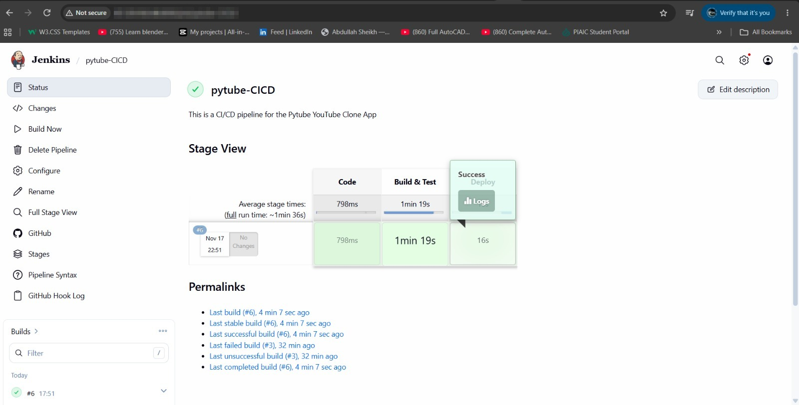
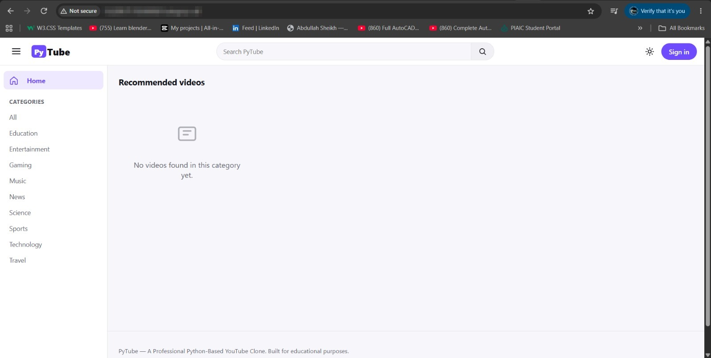
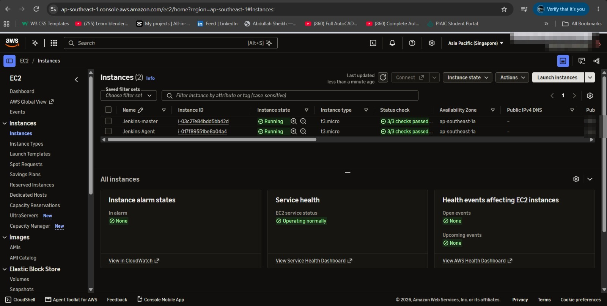

# PyTube CI/CD Pipeline on AWS

A CI/CD pipeline built with **Jenkins** (master + agent) on **AWS EC2** for a Python-based YouTube clone application (PyTube).

> The application code is a sample project used only as the workload for this pipeline. This repository documents the CI/CD setup and deployment that I built on AWS.

## Overview

Every build pulls the source code from GitHub, builds and tests it on a Jenkins agent, and deploys the application. The whole setup runs on AWS EC2 in the Singapore region (`ap-southeast-1`).

```
GitHub  →  Jenkins Master  →  Jenkins Agent (EC2)  →  Build & Test  →  Deploy
```

## What I Built

- Jenkins **master** and Jenkins **agent** on two AWS EC2 instances (`t3.micro`, `ap-southeast-1`)
- A pipeline named `pytube-CICD` with three stages: **Code → Build & Test → Deploy**
- GitHub integration for pulling the source code and triggering builds
- Deployment of the application on AWS, verified in the browser after each successful run

## Pipeline Stages

| Stage | What it does |
|---|---|
| **Code** | Pulls the source code from GitHub |
| **Build & Test** | Builds the application and runs the tests |
| **Deploy** | Deploys the application to the server |

## Pipeline Result

| Item | Value |
|---|---|
| Pipeline name | `pytube-CICD` |
| Latest build | #6, successful |
| Code stage | ~0.8 s |
| Build & Test stage | ~1 min 19 s |
| Deploy stage | ~16 s |
| Full run time | ~1 min 36 s |

## Infrastructure

| Component | Details |
|---|---|
| Jenkins-master | AWS EC2, `t3.micro`, `ap-southeast-1a` |
| Jenkins-Agent | AWS EC2, `t3.micro`, `ap-southeast-1a` |
| Status checks | 3/3 checks passed on both instances |

## Tech Stack

Jenkins · AWS EC2 · GitHub · Linux · Python

## Screenshots

### Jenkins pipeline: all stages successful



### Application running after deployment



### Jenkins master and agent on AWS EC2



## What I Learned

- Setting up a Jenkins master and connecting a separate agent node
- Writing and debugging a multi-stage pipeline (build #3 failed, and the issue was fixed in later builds)
- Running Jenkins on AWS EC2 and managing the instances
- Automating build, test, and deployment of a Python application

## Author

**Abdullah Sheikh**
GitHub: [AbdullahSheikh8873](https://github.com/AbdullahSheikh8873)
